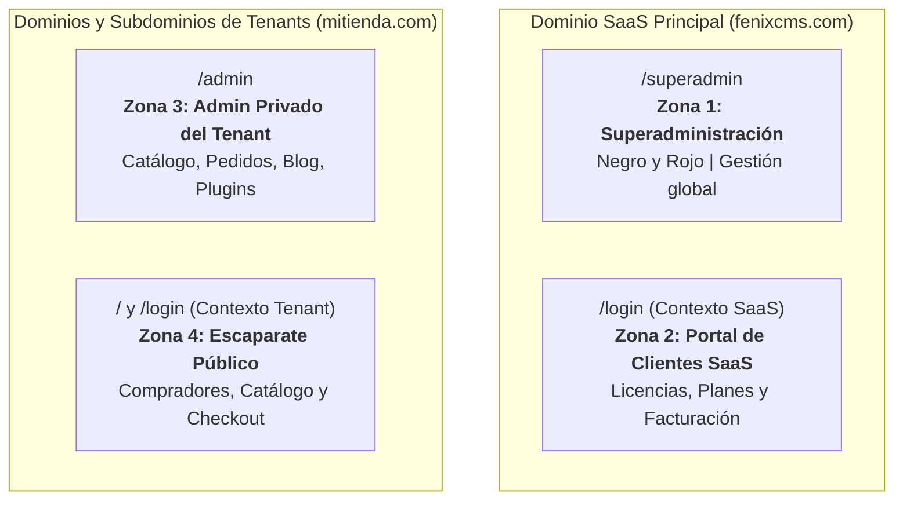

# FenixCMS — Arquitectura General del Sistema

## 1. Visión y Propósito

**FenixCMS SaaS** es una plataforma de comercio y gestión de contenidos multiempresa (multi-tenant), multidominio, multilingüe y modular. Su modelo de negocio está fundamentado en licencias, planes de suscripción (Starter, Pro, Enterprise) y extensiones por módulos y plugins, combinando la flexibilidad de WordPress con la robustez y escalabilidad e-commerce de Shopify.

---

## 2. Las Cuatro Zonas de la Plataforma

Para garantizar seguridad, modularidad y separación de responsabilidades, la plataforma mantiene **cuatro zonas estrictamente diferenciadas**. No se mezclan sesiones, permisos, datos ni interfaces entre ellas:

### Zona 1: Superadministración (`/superadmin`)
- **Acceso:** Restringido exclusivamente al personal de administración global de la plataforma SaaS.
- **Identidad visual:** Estilo profesional y moderno en **negro y rojo**, inspirado en la organización y densidad de información de Amazon, **sin barra superior de búsqueda**.
- **Capacidades clave:**
  - Métricas globales de la plataforma y salud del sistema.
  - Gestión integral de clientes SaaS, contratos y licencias.
  - Aprovisionamiento, suspensión y ciclo de vida de tenants y dominios.
  - Catálogo de módulos, plugins y temas oficiales.
  - Gestión de planes (Starter, Pro, Enterprise) y periodicidad de precios (mensual, trimestral, semestral, anual).
  - Auditoría de actividad, registros de seguridad y control de pagos.

### Zona 2: Portal de Clientes SaaS (`/login` en dominio SaaS)
- **Acceso:** Clientes o empresas que contratan FenixCMS como servicio para operar sus tiendas o sitios web.
- **Capacidades clave:**
  - Panel de autogestión de la cuenta y perfil empresarial.
  - Contratación, renovación y cancelación de planes y suscripciones.
  - Gestión de licencias y dominios activados vinculados a sus tenants.
  - Compra y activación de módulos adicionales, plugins y temas.
  - Historial de transacciones, descargas de facturas y configuración de métodos de pago (PayPal).

### Zona 3: Administración Privada de Tenants (`/admin`)
- **Acceso:** Propietarios y administradores de una tienda o negocio específico, resolviendo bajo su propio subdominio (`tienda1.fenixcms.com`) o dominio personalizado (`mitienda.es`).
- **Aislamiento:** Estricto aislamiento multi-tenant. Cada tenant opera como una isla lógica independiente.
- **Capacidades clave:**
  - Catálogo de productos, variantes, categorías e inventario.
  - Gestión de pedidos, envíos y clientes compradores.
  - Creación de páginas de contenido, menús y blog (experiencia fluida inspirada en WordPress).
  - Activación y configuración de módulos y plugins contratados para su tenant.
  - Personalización de temas visuales y configuración lingüística.

### Zona 4: Dominio Público del Tenant (Escaparate y Clientes Compradores)
- **Acceso:** Abierto a los compradores y visitantes finales de la tienda del tenant.
- **Capacidades clave:**
  - Navegación del escaparate, catálogo, filtros de búsqueda y páginas informativas.
  - Carrito de compra y pasarelas de pago seguras para pedidos.
  - Acceso de compradores mediante `/login` (resuelto en el contexto específico de esa tienda).
  - Área personal del comprador (historial de pedidos, direcciones y descargas).

---

## 3. Principios de Aislamiento y Datos

1. **Aislamiento a Nivel Lógico y de Consulta:**
   - Cada entidad perteneciente a un tenant lleva consigo su identificador obligatorio (`tenantId`).
   - El acceso a datos se valida a nivel de capa de servicio / ORM para imposibilitar la fuga de información o cruce de datos entre tiendas.
2. **Independencia de Sesiones:**
   - Las sesiones de superadministrador, cliente SaaS, administrador de tienda y comprador final son totalmente independientes y utilizan cookies con nombres y alcances separados.
3. **Cero Confianza en Parámetros de Cliente:**
   - Permisos, planes, importes y módulos activos siempre se validan del lado del servidor.
