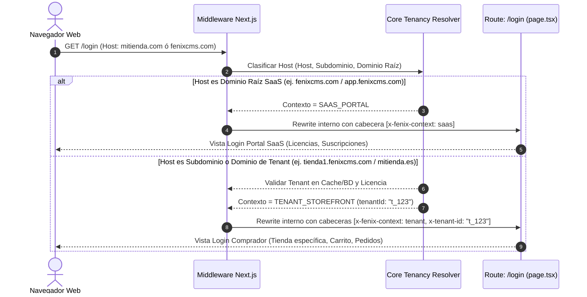

# Estrategia de Enrutamiento y Resolución Contextual de `/login`

## 1. Problema y Principio de Solución

La plataforma requiere que la ruta `/login` sirva para dos propósitos fundamentalmente distintos según quién y desde dónde se accede:

1. **Portal de Clientes SaaS:** Usuarios que contratan la infraestructura de FenixCMS, licencias, planes y facturación.
2. **Escaparate del Tenant:** Compradores y clientes finales que compran productos o interactúan con una tienda específica.

**Requisito obligatorio:** Mantener una **única ruta física de entrada (`/login`)** en Next.js App Router, sin crear páginas duplicadas ni rutas artificiales. La diferenciación debe resolverse en tiempo de ejecución analizando el **dominio solicitante (host)** y el **contexto de aplicación**.

---

## 2. Flujo de Detección Contextual por Dominio

El enrutamiento se apoya en el Middleware de Next.js (`middleware.ts`) que intercepta cada petición entrante antes de renderizar la página o ejecutar Server Actions.



---

## 3. Matriz de Resolución de Contexto

| Dominio Solicitado | Ruta Solicitada | Clasificación de Contexto | Destino Funcional | Cookie de Sesión Utilizada |
| :--- | :--- | :--- | :--- | :--- |
| `fenixcms.com`<br/>`app.fenixcms.com`<br/>`localhost:3000` | `/login` | **SAAS_PORTAL** | Acceso a Clientes SaaS (Gestión de licencias y facturación) | `__Host-fenix_saas_session` |
| `tienda1.fenixcms.com`<br/>`mitienda.es`<br/>`localhost:3000` *(con subdominio)* | `/login` | **TENANT_STOREFRONT** | Acceso a Compradores de la tienda del Tenant | `__Host-fenix_tenant_{tenantId}_session` |
| `fenixcms.com`<br/>`superadmin.fenixcms.com` | `/superadmin` | **SUPERADMIN** | Panel de Superadministrador Global (Credenciales de alto privilegio) | `__Host-fenix_superadmin_session` |
| Dominio del Tenant | `/admin` | **TENANT_ADMIN** | Panel de control privado del comerciante / tenant | `__Host-fenix_tenant_admin_{tenantId}_session` |

---

## 4. Implementación en la Ruta Única `/login/page.tsx`

La página `/login/page.tsx` actúa como un **Server Component despachador**:

```typescript
// Esquema conceptual del despachador /login/page.tsx
import { headers } from "next/headers";
import { SaasCustomerLoginForm } from "@/components/customer/SaasCustomerLoginForm";
import { TenantCustomerLoginForm } from "@/components/tenant/TenantCustomerLoginForm";

export default async function LoginPage() {
  const headersList = await headers();
  const context = headersList.get("x-fenix-context"); // "saas" | "tenant"
  const tenantId = headersList.get("x-tenant-id");

  if (context === "tenant" && tenantId) {
    // Renderiza la interfaz adaptada a la tienda del tenant,
    // con el branding, tema e idioma de dicho tenant
    return <TenantCustomerLoginForm tenantId={tenantId} />;
  }

  // Por defecto en el dominio SaaS raíz: renderiza el portal de clientes SaaS
  return <SaasCustomerLoginForm />;
}
```

---

## 5. Ventajas de esta Arquitectura

1. **URLs limpias y canónicas:** Tanto para la plataforma SaaS como para cada tienda, la ruta universal de inicio de sesión sigue siendo `/login`.
2. **Cero colisiones:** Un cliente de una tienda no puede autenticarse con sus credenciales de compra dentro del portal de administración SaaS, ni viceversa.
3. **Optimización SEO y marca:** Cada tienda mantiene su identidad visual y dominios personalizados de forma totalmente transparente.
4. **Mantenibilidad:** Toda la lógica de discriminación está concentrada en el núcleo (`src/core/tenancy`), evitando duplicación de código en la capa de vistas.
