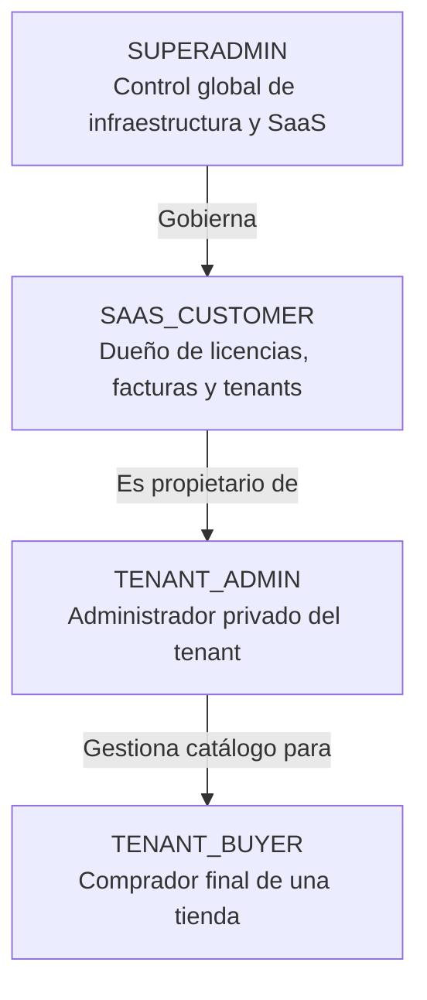

# Aislamiento de Sesiones, Cookies y Permisos

## 1. Principio Rector

La seguridad de FenixCMS SaaS descansa en el **principio de menor privilegio** y en la **separación criptográfica y contextual absoluta** de las identidades de usuario. 

Bajo ninguna circunstancia una sesión emitida para una tienda o tenant otorgará acceso al portal SaaS, y ninguna sesión de comprador en un tenant permitirá acceso al panel de administración `/admin` del mismo u otro tenant.

---

## 2. Estrategia de Cookies y Atributos de Seguridad

Todas las cookies de sesión generadas por la plataforma implementan obligatoriamente los siguientes estándares de endurecimiento (hardening):

- **Prefijo de seguridad:** Uso de `__Host-` en entornos de producción (garantiza que la cookie solo pueda ser enviada al host exacto, sin subdominios compartidos no deseados, con `Secure=true` y `Path=/`).
- **`HttpOnly = true`:** Inaccesible desde JavaScript en el navegador, mitigando ataques de robo de sesión por Cross-Site Scripting (XSS).
- **`Secure = true`:** Solo transmitida a través de conexiones cifradas HTTPS.
- **`SameSite = "Lax"` (o `"Strict"` en paneles administrativos):** Protección proactiva contra Cross-Site Request Forgery (CSRF).

### Convención de Nombres de Cookies por Zona

```
Zona Superadmin:               __Host-fenix_superadmin_token
Zona Cliente SaaS:             __Host-fenix_saas_customer_token
Zona Administración Tenant:    __Host-fenix_tenant_admin_{tenantId}_token
Zona Comprador de Tienda:      __Host-fenix_store_buyer_{tenantId}_token
```

---

## 3. Modelo de Tokens y Carga Útil (Payload)

Cada token de sesión firmado en el servidor encapsula los datos mínimos requeridos para su validación, incluyendo explícitamente el **ámbito (`scope`)** y el **identificador de tenant (`tenantId`)**:

```json
{
  "sub": "usr_98a76d54",
  "role": "TENANT_CUSTOMER",
  "scope": "TENANT_ZONE",
  "tenantId": "tnt_44b1c23a",
  "iss": "fenixcms-auth",
  "exp": 1793740800,
  "iat": 1762204800
}
```

### Reglas de Validación en Servidor

1. **Verificación de Zona:**
   - Si una petición se dirige a `/admin`, el validador exige `scope == "TENANT_ADMIN"` y que el `tenantId` del token coincida exactamente con el tenant activo del host.
   - Si una petición se dirige a `/superadmin`, el validador exige `scope == "SUPERADMIN"`. Un token con cualquier otro rol o scope es rechazado inmediatamente con código HTTP `403 Forbidden`.
2. **Validación de Tenant Activo y Licencia:**
   - En cada operación sensible dentro de `/admin` o el escaparate, el sistema valida que el tenant esté en estado `ACTIVE` y cuente con una licencia vigente. Si la licencia ha expirado o ha sido suspendida por el Superadmin, se bloquea el acceso de inmediato.
3. **Imposibilidad de Escalada Horizontal (Cross-Tenant Leak):**
   - Todas las consultas a base de datos aplican forzosamente una cláusula con el `tenantId` verificado del token. Ningún identificador enviado por el cliente en el cuerpo de la petición (body) o en parámetros de ruta (query/params) puede sobreescribir el `tenantId` autenticado.

---

## 4. Jerarquía de Roles y Matriz de Permisos



| Rol | Ámbito Permitido | Acceso a `/superadmin` | Acceso a `/admin` | Acceso al Portal SaaS | Acceso a Escaparate Tenant |
| :--- | :--- | :---: | :---: | :---: | :---: |
| **Superadmin** | Global | **SÍ** | Solo modo soporte auditado | **SÍ** (auditoría) | Solo vista pública |
| **SaaS Customer** | Suscripción SaaS | **NO** | Solo si es admin de su tenant | **SÍ** | Solo como comprador |
| **Tenant Admin** | Un único tenant | **NO** | **SÍ** (su tenant) | **NO** | Vista previa / gestión |
| **Tenant Buyer** | Tienda específica | **NO** | **NO** | **NO** | **SÍ** (su cuenta de compras) |

---

## 5. Prevención de Ataques y Auditoría

- **Ataques de Fuerza Bruta:** Rate limiting a nivel de IP y usuario en todos los endpoints de autenticación.
- **CSRF:** Tokens de validación anti-falsificación en formularios y verificación estricta de encabezados `Origin` y `Referer`.
- **Registro de Auditoría Obligatorio:** Todos los intentos fallidos de inicio de sesión, cambios de contraseña, elevaciones de privilegios o accesos administrativos quedan registrados de forma inmutable con marca de tiempo, IP, agente de usuario y resultado.
